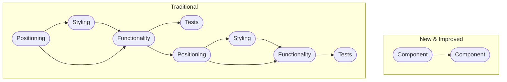

+++
date = '2026-10-24T11:59:00-03:00'
images = ['/images/epic-games-blog-image.png']
tags = ['dream', 'htmx', 'locality-of-behaviour', 'logic', 'markdown', 'typescript', 'vue', 'svelte', 'type-theory', 'web-development']
title = 'Markdown Oriented Programming'
+++

>In which we analyse a solution to the [Locality of Behaviour](https://htmx.org/essays/locality-of-behaviour/) question from the subconscious.

## Introduction

It was revealed to me in a dream.

Epic Games (who suddenly had a web engineering blog) published a post about a store revamp and a new repository model they invented for it.

In the "Traditional" repository model, implementation details such as placement, functionality and looks are scattered through the repo. In this "New and Improved" model, Epic managed to separate everything into individual components, so trying to build a mental model around the codebase was simple.



>Side-by-side comparison of web repository models. On the left is the "traditional" model and on the right the "new and improved" model from the dream.

Let's have a refresher on how the "traditional" model works. Take this `form` I once wrote as an example:

```html
<form action="/api/v1/trips" hx-post="/api/v1/trips" hx-swap="outerHTML" method="POST">
  <fieldset>
    <legend>Personal Information</legend>
    <label for="name">Name</label>
    <input id="name" type="text" maxlength="64" name="name" required="">
  </fieldset>
  <fieldset>
    <legend>Trip Type</legend>
    <input id="oneWay" type="radio" name="trip" value="oneWay" required="">
    <label for="oneWay">One Way</label>
    <input id="return" type="radio" name="trip" value="return" required="">
    <label for="return">Return</label>
    <input id="roundTrip" type="radio" name="trip" value="roundTrip" required="">
    <label for="roundTrip">Roundtrip</label>
  </fieldset>
  <button type="submit">Schedule Trip</button>
</form>
```

To have a complete understanding of how it works, we have to:

1. See where it's positioned in the website's HTML.
2. See how it's styled in the website's CSS.
3. See how the server handles a request to `/api/v1/trips`, specifically how it handles `POST` requests.
4. See the test file to get a taste of how it works.
5. (Bonus) Discover what that [hx-swap](https://htmx.org/attributes/hx-swap/) thingy even is for.

That requires visiting three to four files if you follow [Separation of Concerns (SoC)](https://en.wikipedia.org/wiki/Separation_of_concerns).

The Epic Games model managed to connect everything related to a component by using an in-house solution called `EpicStoreKV`, which was basically a map where the keys were file paths to Markdown files (`MdFile` type, which we'll expand on later) and the values were anything connected to the component (styling, tests, images, ...).

So, in the Epic Games model, all you'd have to do to wrap your head around a component was to check its `EpicStoreKV` entry.

Just one issue, though:


Per a silly comparison image, it was implied that, to adopt this new model, all functions should receive a single argument of `MdFile` type. `MdFile` being a **path to a file containing *valid* Markdown**:

```typescript
const bar = foo("path/to/file.md");
```

## `MdFile`

Needless to say, having *every* single function parse a Markdown file every time it's called seems like a nightmare.

But let's leave that aside for a moment. Take this formal definition of `MdFile`:

**Definition 1**

A value $x$ is of type `MdFile` if, and only if, it is a `string` that resolves to a path containing **valid** Markdown:

```math
x \in \mathrm{MdFile} \iff x \in \mathrm{String} \land \mathrm{isValidMarkdown}(\mathrm{readFile}(x))
```

Alright, that seems to make sense.

One issue, though. Is *invalid* Markdown even a thing?

Well, per [RFC 7763](https://www.rfc-editor.org/info/rfc7763/):

>[...] there is no such thing as "invalid" Markdown.

If a parser doesn't recognize some syntax, it should simply treat that bit as text.

So, if any sequence of characters is valid Markdown, then `isValidMarkdown` is actually a [tautology](https://en.wikipedia.org/wiki/Tautology_(logic)), simplifying our definition.

**Corollary 1**

Since `isValidMarkdown` is always true for any existing file, **Definition 1** simplifies to:

```math
x \in \mathrm{MdFile} \iff x \in \mathrm{String} \land \mathrm{fileExists}(x)
```

So... dreamworld Epic Games gave itself a medal for reinventing [pathlib.Path](https://docs.python.org/3/library/pathlib.html#pathlib.Path)?

## It Was Vue All Along

Taking only the **unified component file** aspect of the dream into consideration, we see that [Vue](https://vuejs.org/), through [Vitest](https://vitest.dev/), successfully unifies positioning, styling, functionality, and tests into a single file:

```vue
<script setup>
import { ref } from 'vue';

const name = ref('');
const tripType = ref('oneWay');

async function handleSubmit() {
  await fetch('/api/v1/trips', {
    body: JSON.stringify({ name: name.value, trip: tripType.value }),
    headers: { 'Content-Type': 'application/json' },
    method: 'POST',
  });
}
</script>

<template>
  <form @submit.prevent="handleSubmit">
    <fieldset>
      <legend>Personal Information</legend>
      <label for="name">Name</label>
      <input id="name" v-model="name" type="text" maxlength="64" required />
    </fieldset>
    <fieldset>
      <legend>Trip Type</legend>
      <label><input type="radio" value="oneWay" v-model="tripType" />One Way</label>
      <label><input type="radio" value="return" v-model="tripType" />Return</label>
      <label><input type="radio" value="roundTrip" v-model="tripType" />Roundtrip</label>
    </fieldset>
    <button type="submit">Schedule Trip</button>
  </form>
</template>

<style scoped>
  form {
    border-radius: 24px;
    box-shadow: 0 0 6px var(--md-sys-color-shadow);
    display: flex;
    flex-direction: column;
    gap: 2rem;
    padding: 2rem;
    position: relative;
  }
</style>

<test>
import { mount } from '@vue/test-utils';
import { expect, test } from 'vitest';
import TripForm from './TripForm.vue';

test('Submits trip form with user input', async () => {
  const wrapper = mount(TripForm);

  await wrapper.find('input#name').setValue('Gabriel');
  await wrapper.find('input[value="return"]').setChecked();
  await wrapper.find('form').trigger('submit');

  expect(wrapper.find('input#name').element.value).toBe('Gabriel');
});
</test>
```

[Svelte](https://svelte.dev/) also achieves this!

## Conclusion

Notice that, even in the Vue example, we still have to investigate how the server handles requests, as indicated by that `fetch('/api/v1/trips')` bit. The `EpicStoreKV` model, no matter how convoluted it might be, still surpasses current framework options in this regard.

I still love [HTMX](https://htmx.org/), but it seems my subconscious is still in search of the Locality of Behaviour Holy Grail.
